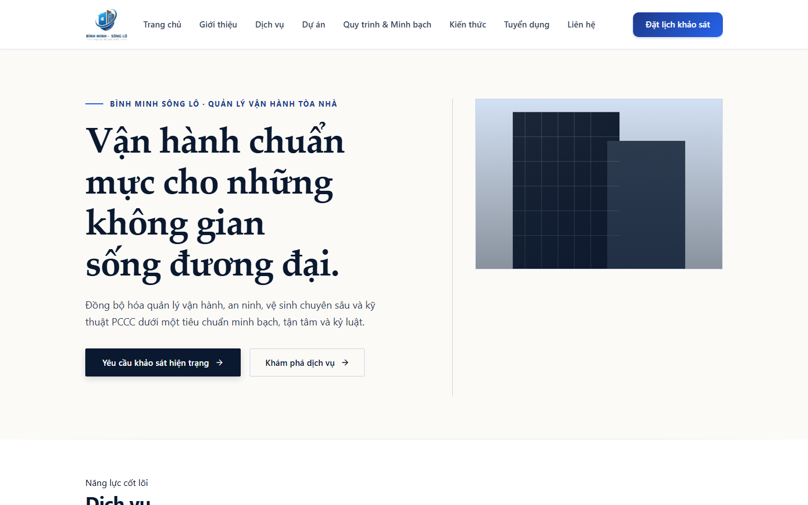
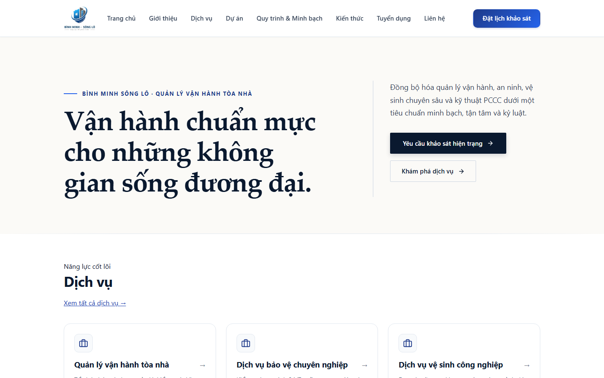
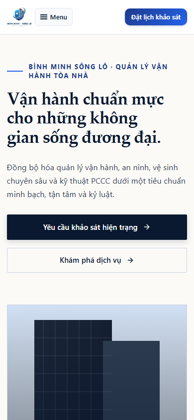
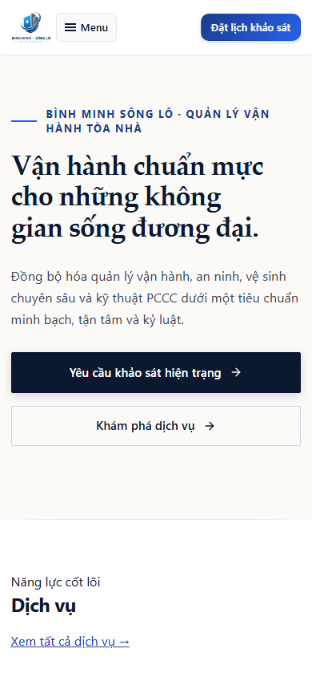
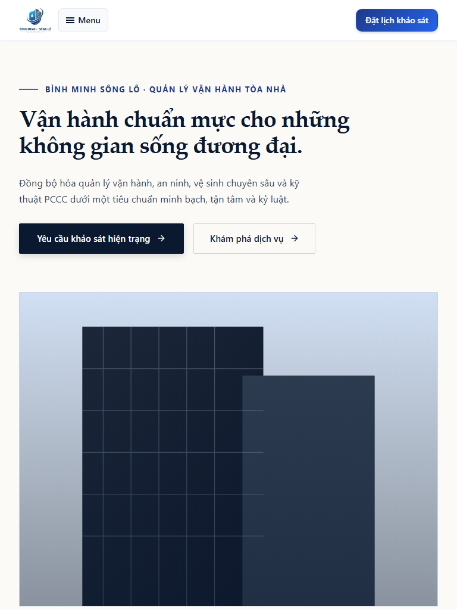
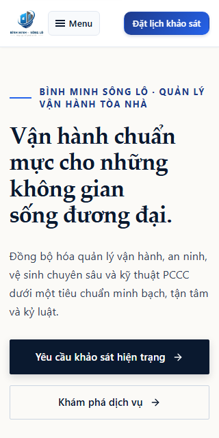

# Visual QA & Art Direction Acceptance Evidence

This directory contains verified screenshot artifacts and accessibility audit proof for **Issue #106** (Design Plan: Premium Architectural Hero Section), **Issue #110** (Architectural Editorial Hero Refinement — Figma nodes `9:2`, `9:46`, `9:80`, `9:108`), and **Issue #102** (CMS Contract: HomePage Hero Model).

All screenshots are generated from the Architectural Editorial Hero implementation (`HeroSection.tsx` + `site.css`) and verified with Playwright and `@axe-core/playwright`.

---

## 1. Visual Proof Across Breakpoints

### A. Desktop Viewport (1440 × 900)

#### With Approved Architectural Image (Figma `9:2`):

#### Fail-Closed Text-First Editorial Fallback — No Media / Unconfirmed Media (Figma `9:80`):

---

### B. Mobile Viewport (390 × 844)

#### With Architectural Image (Figma `9:46`):

#### Fail-Closed Text-First Editorial Fallback (Figma `9:108`):

---

### C. Tablet & Compact Mobile

#### Tablet (768 × 1024):

#### Compact Mobile (320 × 640):

---

## 2. Breakpoint & Overflow Scorecard

| Viewport Target | Width × Height | Visual Layout | Horizontal Overflow | Result |
| :--- | :--- | :--- | :---: | :---: |
| **Desktop High-Res** | 1440 × 900 | Asymmetric editorial columns + vertical architectural hairline | **0px** | PASS |
| **Small Desktop / Laptop** | 1024 × 768 | Proportional asymmetric editorial grid | **0px** | PASS |
| **Tablet Portrait** | 768 × 1024 | Stacked editorial column | **0px** | PASS |
| **Mobile Standard** | 390 × 844 | Full-width touch targets, responsive clamp | **0px** | PASS |
| **Mobile Compact** | 320 × 640 | Zero clipping, single-column typographic flow | **0px** | PASS |

---

## 3. Accessibility, Typography & Performance Proof

* **Axe Core WCAG 2.0 / 2.1 AA:** **0 violations** (Verified via `@axe-core/playwright`).
* **Vietnamese Editorial Serif Typography:** Uses a Vietnamese-complete serif stack (`'Noto Serif', 'Source Serif 4', 'Palatino Linotype', 'Book Antiqua', 'Times New Roman', serif`) that covers the full Latin Extended Additional (`U+1EA0`–`U+1EFF`) block without falling back to `Georgia` (which lacks composite Vietnamese diacritics on Windows).
* **Cumulative Layout Shift (CLS):** **0.00** (Explicit image dimensions & aspect-ratio container prevent layout reflow).
* **LCP Optimization:** `fetchPriority="high"`, `decoding="async"`, and native eager load.
* **Pure Typographic Fallback:** When no `APPROVED` image is configured, the Hero renders a two-column editorial composition without any synthetic dashboard matrix or unconfirmed claims.
